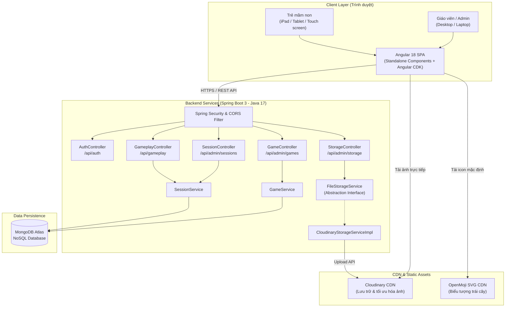
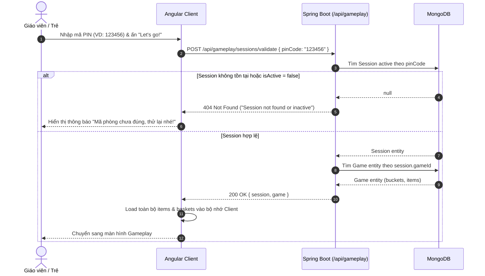
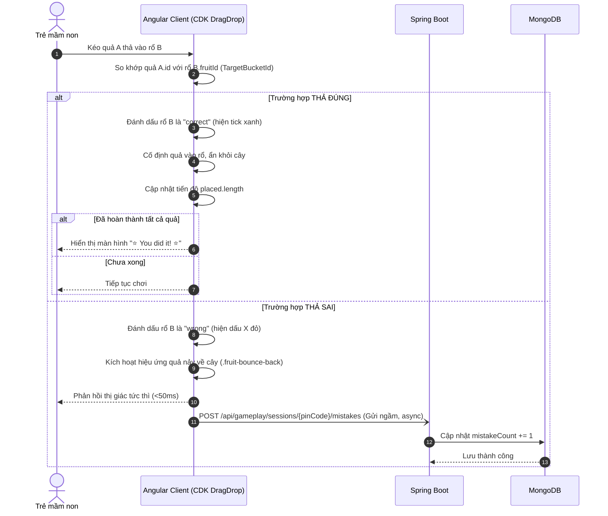
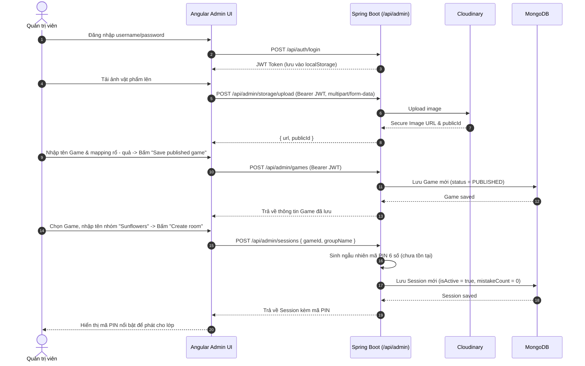

# Tài liệu Kiến trúc Hệ thống (Architecture Document)

Tài liệu này cung cấp cái nhìn toàn diện về kiến trúc hệ thống, các luồng dữ liệu, quy chuẩn bảo mật và chi tiết kỹ thuật của dự án **Kid Game Edu**.

---

## 1. Tổng quan Kiến trúc Hệ thống

Hệ thống được xây dựng theo mô hình **Client-Server tách biệt (Decoupled Architecture)**. Thiết kế này giúp tối ưu hóa hiệu năng, tách bạch trách nhiệm và cho phép triển khai, mở rộng độc lập giữa tầng giao diện (Frontend) và tầng dịch vụ (Backend).



---

## 2. Luồng Dữ liệu & Sơ đồ Tuần tự (Sequence Diagrams)

### 2.1. Luồng Xác thực PIN & Khởi tạo Màn chơi (Join Room)
Giáo viên hoặc trẻ nhập mã PIN 6 chữ số để mở khóa màn chơi.



### 2.2. Luồng Tương tác Kéo - Thả & Đếm lỗi (Zero-latency Gameplay)
Toàn bộ logic kiểm tra ghép đôi được xử lý tức thời trên Angular. Backend chỉ nhận request bất đồng bộ khi có lỗi sai phát sinh.



### 2.3. Luồng Quản trị: Tạo Game & Cấp mã PIN


---

## 3. Đặc tả Chi tiết Hệ thống REST API

Tất cả API trả về định dạng `application/json` (trừ trường hợp xóa trả về `204 No Content`).

### 3.1. Xác thực & Quản trị Hệ thống (`/api/auth`, `/api/health`)

| Endpoint | Method | Phân quyền | Mô tả | Request Body | Response Body |
| :--- | :--- | :--- | :--- | :--- | :--- |
| `/api/health` | `GET` | Public | Kiểm tra trạng thái hoạt động của Backend | Không | `{"status": "UP"}` (200 OK) |
| `/api/auth/login` | `POST` | Public | Đăng nhập tài khoản Admin, nhận JWT | `{"username": "...", "password": "..."}` | `{"token": "<JWT_STRING>"}` (200 OK) |

### 3.2. Gameplay Public API (`/api/gameplay`)
Dành cho giáo viên và học sinh tham gia phòng chơi, không yêu cầu Bearer Token mà định danh qua `pinCode`.

| Endpoint | Method | Phân quyền | Mô tả | Request Body | Response Body |
| :--- | :--- | :--- | :--- | :--- | :--- |
| `/api/gameplay/sessions/validate` | `POST` | Public | Xác thực mã PIN và lấy toàn bộ dữ liệu Game | `{"pinCode": "123456"}` | `{"session": {...}, "game": {...}}` (200 OK) |
| `/api/gameplay/sessions/{pinCode}` | `GET` | Public | Lấy cấu hình Game theo mã PIN | Không | `Game` object (200 OK) |
| `/api/gameplay/sessions/{pinCode}/mistakes` | `POST` | Public | Tăng số lần thao tác sai của phiên thêm 1 | Không | `Session` object đã cập nhật (200 OK) |

### 3.3. Quản lý Game (Admin Only - Yêu cầu Header `Authorization: Bearer <JWT>`)

| Endpoint | Method | Phân quyền | Mô tả | Request Body | Response Body |
| :--- | :--- | :--- | :--- | :--- | :--- |
| `/api/admin/games` | `GET` | Admin | Lấy danh sách tất cả các trò chơi | Không | `Game[]` (200 OK) |
| `/api/admin/games/{id}` | `GET` | Admin | Lấy chi tiết một trò chơi theo ID | Không | `Game` object (200 OK) |
| `/api/admin/games` | `POST` | Admin | Tạo trò chơi mới | `Game` entity | `Game` entity (201 Created) |
| `/api/admin/games/{id}` | `PUT` | Admin | Cập nhật trò chơi | `Game` entity | `Game` entity (200 OK) |
| `/api/admin/games/{id}/publish` | `POST` | Admin | Chuyển trạng thái sang `PUBLISHED` | Không | `Game` entity (200 OK) |
| `/api/admin/games/{id}` | `DELETE` | Admin | Xóa vĩnh viễn một trò chơi | Không | `204 No Content` |

### 3.4. Quản lý Phiên chơi (Admin Only - Yêu cầu Header `Authorization: Bearer <JWT>`)

| Endpoint | Method | Phân quyền | Mô tả | Request Body | Response Body |
| :--- | :--- | :--- | :--- | :--- | :--- |
| `/api/admin/sessions` | `GET` | Admin | Danh sách tất cả các phòng chơi | Không | `Session[]` (200 OK) |
| `/api/admin/sessions` | `POST` | Admin | Khởi tạo phòng chơi và sinh mã PIN | `{"gameId": "...", "groupName": "..."}` | `Session` entity (201 Created) |
| `/api/admin/sessions/{id}/deactivate` | `POST` | Admin | Đóng phòng chơi (`isActive = false`) | Không | `Session` entity (200 OK) |

### 3.5. Lưu trữ Tài nguyên Hình ảnh (Admin Only - Có điều kiện `cloudinary.enabled=true`)

| Endpoint | Method | Phân quyền | Mô tả | Request Body | Response Body |
| :--- | :--- | :--- | :--- | :--- | :--- |
| `/api/admin/storage/upload` | `POST` | Admin | Tải ảnh lên Cloudinary | `multipart/form-data` (field: `file`) | `{"url": "...", "publicId": "..."}` (201 Created) |
| `/api/admin/storage/{publicId}` | `DELETE` | Admin | Xóa ảnh khỏi Cloudinary | Không | `204 No Content` |

---

## 4. Các Quyết định Kiến trúc (Architectural Decision Records - ADR)

### ADR 01: Xử lý Kiểm tra Đúng/Sai hoàn toàn tại Client (Angular)
- **Bối cảnh:** Đối tượng người dùng là trẻ em mầm non với khả năng tập trung ngắn hạn. Mọi độ trễ mạng (>100ms) khi kéo thả sẽ tạo cảm giác giật, lag và làm giảm sự hứng thú.
- **Quyết định:** Khi nhập PIN, Client tải về toàn bộ cấu trúc bài tập (`buckets` và `items` có gắn `targetBucketId`). Toàn bộ việc so khớp đúng/sai được tính toán ngay trong callback `dropIntoBasket()` của Angular CDK.
- **Hệ quả:**
  - *Ưu điểm:* Phản hồi tức thì (<16ms, cùng tần số làm tươi khung hình 60fps), trải nghiệm mượt mà, không phụ thuộc kết nối internet lúc chơi.
  - *Nhược điểm:* Đáp án nằm ở Client (tuy nhiên với mô hình giáo dục mầm non, tính bảo mật của bài tập không phải là mối đe dọa gian lận).

### ADR 02: Trừu tượng hóa Tầng Lưu trữ Tập tin (`FileStorageService`)
- **Bối cảnh:** Hệ thống cần upload hình ảnh rổ và quả. Hiện tại sử dụng Cloudinary, nhưng có thể cần hỗ trợ lưu trữ nội bộ (Local Disk) hoặc AWS S3 trong tương lai.
- **Quyết định:** Áp dụng nguyên lý *Dependency Inversion (DIP)*. Định nghĩa interface `FileStorageService` trong core backend:
  ```java
  public interface FileStorageService {
      StoredFile upload(MultipartFile file) throws IOException;
      void delete(String publicId) throws IOException;
      record StoredFile(String url, String publicId) {}
  }
  ```
  Class `CloudinaryStorageServiceImpl` hiện thực interface này và được kích hoạt linh hoạt qua `@ConditionalOnProperty(name = "cloudinary.enabled", havingValue = "true")`.

### ADR 03: Bảo mật Phân tầng (JWT cho Admin & PIN cho Gameplay)
- **Bối cảnh:** Lớp học mầm non không thể yêu cầu từng nhóm trẻ đăng nhập tài khoản/mật khẩu phức tạp. Tuy nhiên dữ liệu quản trị cần được bảo vệ chặt chẽ.
- **Quyết định:**
  - Admin sử dụng Spring Security Stateless JWT Filter (`/api/admin/**`).
  - Học sinh chỉ cần mã PIN 6 số (`/api/gameplay/**`), không cần duy trì session phức tạp hay lưu trữ cookie.

---

## 5. Cấu trúc Mô-đun & Mã nguồn

Dự án tổ chức theo cấu trúc Monorepo tập trung:
```
kid-game-edu/
├── backend/                               # Spring Boot 3 Web Application
│   ├── src/main/java/com/kidgameedu/backend/
│   │   ├── auth/                          # Đăng nhập & sinh JWT
│   │   ├── config/                        # SecurityConfig, WebConfig (CORS), SeedData
│   │   ├── exception/                     # GlobalExceptionHandler, ResourceNotFoundException
│   │   ├── game/                          # Controller, Service, Repository cho Game
│   │   ├── gameplay/                      # Public Gameplay API (PIN validation, mistakes)
│   │   ├── model/                         # MongoDB Entities (Admin, Game, Session, Bucket, Item)
│   │   ├── repository/                    # Spring Data Mongo Repositories
│   │   ├── security/                      # JwtService, JwtAuthFilter, UserDetailsService
│   │   ├── session/                       # Controller, Service, Repository cho Session
│   │   └── storage/                       # FileStorageService, CloudinaryStorageServiceImpl
│   ├── src/main/resources/application.yml # Cấu hình ứng dụng
│   ├── Dockerfile                         # Container build với Eclipse Temurin 17 JRE
│   └── pom.xml                            # Maven dependencies
├── frontend/                              # Angular 18 Single Page Application
│   ├── src/app/
│   │   ├── core/                          # Services (ApiService), Models, Interceptors (JwtInterceptor)
│   │   ├── app.component.ts               # Root component điều phối 3 màn hình (PIN, Play, Admin)
│   │   ├── app.component.html             # Template HTML chuẩn touch-friendly
│   │   └── app.component.css              # Styling giao diện mầm non, hoạt ảnh CSS
│   └── package.json                       # Angular CDK, Tailwind CSS
└── docs/                                  # Toàn bộ tài liệu kiến trúc & thiết kế
```

---

## 6. Chiến lược Triển khai & Vận hành (Deployment Architecture)

- **Frontend:** Build tĩnh bằng lệnh `ng build`, triển khai lên CDN như **Vercel** hoặc **Netlify**.
- **Backend:** Đóng gói dạng Docker image thông qua `backend/Dockerfile` chạy trên cổng `8080`, triển khai trên các PaaS như **Render**, **Railway** hoặc Kubernetes cluster.
- **Database:** MongoDB Atlas M0 (Free Tier) hoặc cụm Database chuyên dụng.
- **CORS:** Cấu hình trong `WebConfig.java` cho phép truy cập từ mọi domain (`allowedOriginPatterns("*")`) hoặc domain production chỉ định.
