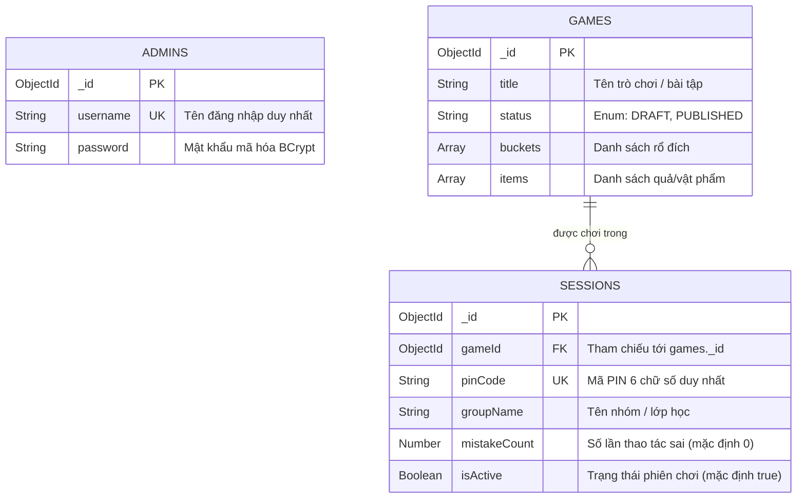

# Thiết kế Cơ sở dữ liệu (Database Schema)

Dự án **Kid Game Edu** sử dụng **MongoDB** (NoSQL Document Database). MongoDB được lựa chọn nhờ cấu trúc Document linh hoạt, cho phép lưu trữ cấu hình bài học dạng phân cấp (Nested Arrays) mà không cần quan hệ bảng phức tạp, đồng thời đáp ứng tốt nhu cầu đọc/ghi nhanh cho các phiên chơi đồng thời.

---

## 1. Sơ đồ Quan hệ Dữ liệu (Entity Relationship Diagram)



---

## 2. Chi tiết các Collection

### 2.1. Collection `admins`
Quản lý thông tin tài khoản và đăng nhập của Quản trị viên hệ thống (Admin/Giáo viên quản lý).

| Tên trường | Kiểu dữ liệu BSON | Kiểu dữ liệu Java | Ràng buộc / Mặc định | Mô tả |
| :--- | :--- | :--- | :--- | :--- |
| `_id` | `ObjectId` | `org.bson.types.ObjectId` | Primary Key, Auto-generated | Định danh duy nhất của tài khoản admin |
| `username` | `String` | `String` | Required, Unique, Not Blank | Tên đăng nhập quản trị viên |
| `password` | `String` | `String` | Required, BCrypt Hash | Mật khẩu tài khoản (đã mã hóa) |

#### Chỉ mục (Indexes):
- `{ "username": 1 }`: Unique Index, đảm bảo không trùng lặp tên đăng nhập (`@Indexed(unique = true)`).

#### Dữ liệu mẫu (JSON Document Example):
```json
{
  "_id": { "$oid": "6627f1a0e1329c48b1112233" },
  "username": "admin",
  "password": "$2a$10$7Z2v1QG9J8D3Q5zW7vL6Xu8c5J2P1M6k3bH5V2G8Q1W9E3R4T5Y6U",
  "_class": "com.kidgameedu.backend.model.Admin"
}
```

---

### 2.2. Collection `games`
Lưu trữ toàn bộ thông tin cấu hình của trò chơi kéo thả. Cấu trúc lồng (Embedded Documents) cho phép đóng gói toàn bộ danh sách rổ và quả trong một Document duy nhất, giúp tải toàn bộ game chỉ với một query đơn.

| Tên trường | Kiểu dữ liệu BSON | Kiểu dữ liệu Java | Ràng buộc / Mặc định | Mô tả |
| :--- | :--- | :--- | :--- | :--- |
| `_id` | `ObjectId` | `org.bson.types.ObjectId` | Primary Key, Auto-generated | Khóa chính của trò chơi |
| `title` | `String` | `String` | Required | Tên hiển thị của trò chơi (VD: "Fruit sorting") |
| `status` | `String` | `GameStatus (Enum)` | Mặc định: `"DRAFT"` | Trạng thái phát hành (`"DRAFT"`, `"PUBLISHED"`) |
| `buckets` | `Array<Object>` | `List<Bucket>` | Mặc định: `[]` | Danh sách các rổ đích nhận vật phẩm |
| `buckets[].id` | `String` | `String` | Required | Mã định danh rổ (VD: `"basket-red"`) |
| `buckets[].imageUrl` | `String` | `String` | Tùy chọn (URL Cloudinary) | Đường dẫn ảnh của rổ |
| `items` | `Array<Object>` | `List<Item>` | Mặc định: `[]` | Danh sách các quả/vật phẩm cần kéo |
| `items[].id` | `String` | `String` | Required | Mã định danh quả (VD: `"apple"`) |
| `items[].imageUrl` | `String` | `String` | Tùy chọn (URL Cloudinary/SVG) | Đường dẫn ảnh của quả |
| `items[].targetBucketId` | `String` | `String` | Required | Trỏ tới `buckets[].id` để kiểm tra đúng/sai |

#### Chỉ mục (Indexes):
- `{ "status": 1 }`: Đơn mục Index giúp lọc nhanh các game đã xuất bản (`PUBLISHED`).

#### Dữ liệu mẫu (JSON Document Example):
```json
{
  "_id": { "$oid": "6627f2b1e1329c48b1114455" },
  "title": "Fruit sorting",
  "status": "PUBLISHED",
  "buckets": [
    {
      "id": "basket-red",
      "imageUrl": "https://placehold.co/240x170/E85D75/ffffff?text=Basket"
    },
    {
      "id": "basket-yellow",
      "imageUrl": "https://placehold.co/240x170/F4C95D/ffffff?text=Basket"
    },
    {
      "id": "basket-green",
      "imageUrl": "https://placehold.co/240x170/79B86A/ffffff?text=Basket"
    },
    {
      "id": "basket-orange",
      "imageUrl": "https://placehold.co/240x170/F29C58/ffffff?text=Basket"
    }
  ],
  "items": [
    {
      "id": "apple",
      "imageUrl": "https://openmoji.org/data/color/svg/1F34E.svg",
      "targetBucketId": "basket-red"
    },
    {
      "id": "lemon",
      "imageUrl": "https://openmoji.org/data/color/svg/1F34B.svg",
      "targetBucketId": "basket-yellow"
    },
    {
      "id": "lime",
      "imageUrl": "https://openmoji.org/data/color/svg/1FAD2.svg",
      "targetBucketId": "basket-green"
    },
    {
      "id": "orange",
      "imageUrl": "https://openmoji.org/data/color/svg/1F34A.svg",
      "targetBucketId": "basket-orange"
    }
  ],
  "_class": "com.kidgameedu.backend.model.Game"
}
```

---

### 2.3. Collection `sessions`
Quản lý các phòng/phiên chơi thực tế trong lớp học. Mỗi nhóm trẻ tham gia chơi sẽ kết nối tới một Session thông qua mã PIN 6 chữ số.

| Tên trường | Kiểu dữ liệu BSON | Kiểu dữ liệu Java | Ràng buộc / Mặc định | Mô tả |
| :--- | :--- | :--- | :--- | :--- |
| `_id` | `ObjectId` | `org.bson.types.ObjectId` | Primary Key, Auto-generated | Khóa chính của phiên chơi |
| `gameId` | `ObjectId` | `org.bson.types.ObjectId` | Required, Foreign Key | ID trò chơi liên kết (`games._id`) |
| `pinCode` | `String` | `String` | Required, Unique (6 digits) | Mã PIN 6 chữ số để trẻ/giáo viên tham gia |
| `groupName` | `String` | `String` | Required | Tên nhóm hoặc tên lớp (VD: `"Sunflowers"`) |
| `mistakeCount` | `Number` (Int32) | `int` | Mặc định: `0` | Tổng số lượt kéo thả sai của nhóm |
| `isActive` | `Boolean` | `boolean` | Mặc định: `true` | Phiên chơi đang hoạt động (`true`) hay đã kết thúc (`false`) |

#### Chỉ mục (Indexes):
- `{ "pinCode": 1 }`: Unique Index, bắt buộc để tìm kiếm phiên chơi cực nhanh và ngăn chặn trùng lặp mã PIN (`@Indexed(unique = true)`).
- `{ "gameId": 1 }`: Hỗ trợ thống kê tất cả các phiên chơi của một trò chơi cụ thể.
- `{ "pinCode": 1, "isActive": 1 }`: Compound Index tối ưu cho câu lệnh truy vấn tìm phòng đang hoạt động: `findByPinCodeAndIsActiveTrue(pinCode)`.

#### Dữ liệu mẫu (JSON Document Example):
```json
{
  "_id": { "$oid": "6627f3c2e1329c48b1116677" },
  "gameId": { "$oid": "6627f2b1e1329c48b1114455" },
  "pinCode": "123456",
  "groupName": "Demo classroom",
  "mistakeCount": 2,
  "isActive": true,
  "_class": "com.kidgameedu.backend.model.Session"
}
```

---

## 3. Khởi tạo & Dữ liệu Mặc định (Seed Data)

Hệ thống cung cấp cơ chế tự động nạp dữ liệu ban đầu thông qua Spring Boot `CommandLineRunner`:

1. **Khởi tạo Tài khoản Admin (`AdminSeedConfig`):**
   - Đọc từ cấu hình `app.admin.username` và `app.admin.password`.
   - Nếu tài khoản chưa tồn tại, hệ thống tự động mã hóa BCrypt và ghi vào collection `admins`.

2. **Khởi tạo Game & Phiên chơi Demo (`DemoDataSeedConfig`):**
   - Kích hoạt khi biến môi trường `app.demo-seed-enabled=true` (hoặc cấu hình trong `application.yml`).
   - Tự động tạo 1 trò chơi mẫu: `"Fruit sorting"` gồm 4 loại quả (`apple`, `lemon`, `lime`, `orange`) tương ứng với 4 rổ màu (`basket-red`, `basket-yellow`, `basket-green`, `basket-orange`).
   - Tự động tạo 1 phiên chơi demo với mã PIN: `123456`, nhóm `"Demo classroom"`.

---

## 4. Nguyên tắc Thiết kế & Lưu ý Mở rộng

1. **Phi chuẩn hóa (Denormalization):**
   - Danh sách `buckets` và `items` được nhúng trực tiếp vào tài liệu `games` thay vì tách thành các collection riêng. Quyết định này giúp tối ưu hóa hiệu năng đọc khi trẻ vào phòng: Client chỉ cần thực hiện 1 truy vấn đơn giản là có toàn bộ dữ liệu để chơi offline/local.
2. **Ngăn chặn Race Condition khi tăng biến đếm lỗi (`mistakeCount`):**
   - Hiện tại logic tăng đếm lỗi được thực hiện bằng cách đọc Session, tăng biến đếm trong Java và lưu lại. Khi mở rộng nhiều client ghi đồng thời, có thể chuyển sang dùng toán tử nguyên tử MongoDB `$inc`:
     ```javascript
     db.sessions.updateOne({ pinCode: "123456", isActive: true }, { $inc: { mistakeCount: 1 } })
     ```
3. **Sinh mã PIN 6 chữ số:**
   - Mã PIN ngẫu nhiên trong khoảng `100000` - `999999`. Service tự động kiểm tra trùng lặp qua `sessionRepository.existsByPinCode(...)` trước khi lưu.
