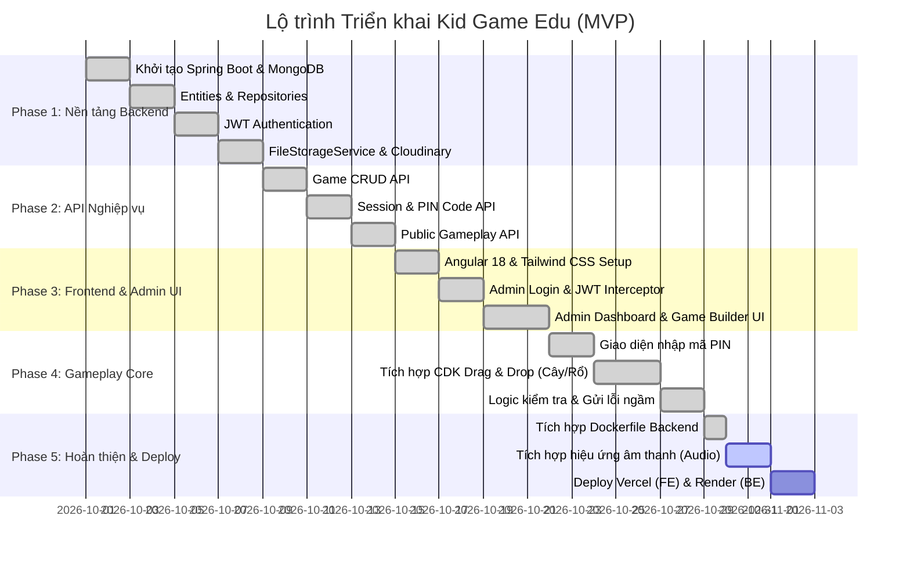

# Kế hoạch Triển khai (Implementation Plan)

Tài liệu này theo dõi lộ trình triển khai chi tiết cho dự án **Kid Game Edu**, phân chia theo từng Phase công việc, đồng thời cập nhật trạng thái thực tế của mã nguồn (`[x]` Đã hoàn thành, `[/]` Đang triển khai, `[ ]` Chưa bắt đầu).

---

## 1. Bảng Tổng hợp Tiến độ Dự án



---

## 2. Chi tiết các Phase & Trạng thái Công việc

### Phase 1: Nền tảng Backend & Cơ sở dữ liệu
*Mục tiêu:* Thiết lập khung dự án Spring Boot, kết nối cơ sở dữ liệu MongoDB, cấu hình bảo mật và dịch vụ lưu trữ.

- [x] **Task 1.1: Khởi tạo dự án Spring Boot & cấu hình MongoDB**
  - Cấu hình Maven `pom.xml` với Spring Boot 3.4.4, Java 17, Spring Data MongoDB.
  - Cấu hình file `application.yml` hỗ trợ biến môi trường `MONGODB_URI`.
  - Thiết lập `HealthController` (`/api/health`) để kiểm tra trạng thái dịch vụ.
  - *Files:* `backend/pom.xml`, `backend/src/main/resources/application.yml`, `HealthController.java`.

- [x] **Task 1.2: Định nghĩa các Data Model (Entities) & Repositories**
  - Tạo model `Admin` với username độc nhất (`@Indexed(unique = true)`).
  - Tạo model `Game` chứa danh sách nhúng `Bucket` và `Item`.
  - Tạo model `Session` chứa mã PIN 6 số, biến đếm lỗi `mistakeCount` và trạng thái `isActive`.
  - *Files:* `model/Admin.java`, `model/Game.java`, `model/Session.java`, `model/Bucket.java`, `model/Item.java`, `repository/*.java`.

- [x] **Task 1.3: Xây dựng cơ chế Xác thực & Phân quyền (JWT)**
  - Tích hợp thư viện JJWT 0.12.6.
  - Triển khai `JwtService` sinh và xác thực JWT token.
  - Cấu hình `SecurityConfig`, `JwtAuthenticationFilter` và `AdminUserDetailsService`.
  - Xây dựng API `POST /api/auth/login` cấp token cho Admin.
  - Xây dựng `AdminSeedConfig` tự động khởi tạo admin mặc định nếu được cấu hình.
  - *Files:* `security/*.java`, `auth/AuthController.java`, `config/SecurityConfig.java`, `config/AdminSeedConfig.java`.

- [x] **Task 1.4: Thiết kế Tầng trừu tượng Lưu trữ (Storage Abstraction)**
  - Định nghĩa Interface `FileStorageService` tuân thủ nguyên lý Dependency Inversion.
  - Hiện thực `CloudinaryStorageServiceImpl` kết nối với Cloudinary SDK.
  - Cấu hình `@ConditionalOnProperty(name = "cloudinary.enabled")` cho phép linh hoạt bật/tắt.
  - *Files:* `storage/FileStorageService.java`, `storage/CloudinaryStorageServiceImpl.java`, `config/CloudinaryConfig.java`.

---

### Phase 2: API Nghiệp vụ Hệ thống (Backend)
*Mục tiêu:* Cung cấp toàn bộ các API phục vụ quản lý bài học, phiên chơi và hỗ trợ tương tác gameplay.

- [x] **Task 2.1: Xây dựng CRUD API cho Game (`/api/admin/games`)**
  - `GET /api/admin/games`: Lấy danh sách trò chơi.
  - `GET /api/admin/games/{id}`: Xem chi tiết trò chơi.
  - `POST /api/admin/games`: Tạo mới trò chơi.
  - `PUT /api/admin/games/{id}`: Chỉnh sửa cấu hình trò chơi.
  - `POST /api/admin/games/{id}/publish`: Xuất bản trò chơi.
  - `DELETE /api/admin/games/{id}`: Xóa trò chơi.
  - *Files:* `game/GameController.java`, `game/GameService.java`.

- [x] **Task 2.2: Xây dựng API Quản lý Session (`/api/admin/sessions`)**
  - Thuật toán sinh mã PIN 6 số ngẫu nhiên không trùng lặp (`generateUniquePin()`).
  - API tạo phiên chơi mới cho nhóm học sinh (`POST /api/admin/sessions`).
  - API đóng phiên chơi (`POST /api/admin/sessions/{id}/deactivate`).
  - Thống kê danh sách phòng chơi và số lỗi sai của từng nhóm (`GET /api/admin/sessions`).
  - *Files:* `session/SessionController.java`, `session/SessionService.java`.

- [x] **Task 2.3: Xây dựng API Gameplay Public (`/api/gameplay`)**
  - `POST /api/gameplay/sessions/validate`: Xác thực mã PIN và trả về đồng thời Session + Game cấu hình.
  - `GET /api/gameplay/sessions/{pinCode}`: Lấy dữ liệu Game theo mã PIN.
  - `POST /api/gameplay/sessions/{pinCode}/mistakes`: Tăng số lượng thao tác sai của nhóm lên 1.
  - Khởi tạo seed data demo (`DemoDataSeedConfig`) phục vụ thử nghiệm không cần thao tác tay.
  - *Files:* `gameplay/GameplayController.java`, `config/DemoDataSeedConfig.java`.

---

### Phase 3: Nền tảng Frontend & Giao diện Quản trị
*Mục tiêu:* Khởi tạo ứng dụng Angular hiện đại, giao diện trực quan cho giáo viên quản lý học cụ.

- [x] **Task 3.1: Khởi tạo Angular 18 & cấu hình giao diện**
  - Thiết lập dự án Angular Standalone Components.
  - Cấu hình Tailwind CSS và font chữ thân thiện với trẻ em.
  - Thiết lập `JwtInterceptor` tự động đính kèm Bearer token vào các request `/api/admin/**`.
  - Định nghĩa Data Models TypeScript (`auth.models.ts`, `game.models.ts`).
  - *Files:* `frontend/src/app/core/`, `frontend/tailwind.config.js`.

- [x] **Task 3.2: Xây dựng Giao diện Đăng nhập Quản trị viên**
  - Modal đăng nhập chuyên nghiệp ("Teacher Desk").
  - Lưu trữ JWT vào `localStorage` khi đăng nhập thành công.
  - Xử lý thông báo lỗi đăng nhập trực quan.
  - *Files:* `app.component.html`, `app.component.ts`, `app.component.css`.

- [x] **Task 3.3: Xây dựng Bàn làm việc Quản trị (Admin Desk & Dashboard)**
  - Giao diện Game Builder: Nhập tên bài tập, tạo danh sách quả và ánh xạ tới rổ tương ứng.
  - Tích hợp tải ảnh trực tiếp từ trình duyệt lên qua `StorageController`.
  - Khởi tạo phòng chơi mới bằng cách chọn game và nhập tên nhóm.
  - Bảng thống kê "Today's activity" hiển thị trực tiếp danh sách phòng, mã PIN, số lỗi và trạng thái.
  - *Files:* `app.component.html`, `app.component.ts`.

---

### Phase 4: Trải nghiệm Gameplay Kéo - Thả (Core Frontend)
*Mục tiêu:* Mang lại trải nghiệm chơi game mượt mà, phản hồi lập tức và tối ưu hóa thao tác chạm trên màn hình cảm ứng.

- [x] **Task 4.1: Xây dựng Màn hình Nhập mã PIN (Pin Screen)**
  - Giao diện mầm non thân thiện với linh vật mầm cây, đám mây trôi.
  - Ô nhập mã PIN cỡ lớn, định dạng bàn phím số ảo trên thiết bị di động.
  - Nút "Let's go!" nổi bật, xử lý phím tắt Enter.
  - Thông báo lỗi thân thiện khi mã PIN không chính xác.
  - *Files:* `app.component.html`, `app.component.ts`.

- [x] **Task 4.2: Tích hợp Angular CDK Drag & Drop**
  - Hiển thị cây cổ thụ với các quả treo ở vị trí ngẫu nhiên trên tán lá.
  - Hàng rổ màu phía dưới được định cấu hình làm vùng thả (`cdkDropListConnectedTo`).
  - Tự động thay thế icon mặc định bằng SVG OpenMoji nếu bài học chưa có ảnh tùy chỉnh.
  - *Files:* `app.component.html`, `app.component.ts`, `app.component.css`.

- [x] **Task 4.3: Xử lý Logic Kéo - Thả Zero-Latency**
  - So khớp `fruit.id === basket.fruitId` ngay trong callback `dropIntoBasket`.
  - **Trường hợp đúng:** Quả biến mất khỏi cây, gắn vào rổ, rổ chuyển viền xanh kèm dấu tick (`✓`), thanh tiến độ cập nhật.
  - **Trường hợp sai:** Rổ nháy viền đỏ kèm dấu nhân (`×`), quả kích hoạt hoạt ảnh nảy ngược về cây (`.fruit-bounce-back`), âm thầm gọi API tăng số lỗi ngầm.
  - **Hoàn thành bài học:** Màn hình chúc mừng lớn với biểu tượng sao: *"⭐ You did it! ⭐"*.
  - *Files:* `app.component.ts`, `app.component.css`.

---

### Phase 5: Hoàn thiện, Âm thanh & Triển khai (Polish & Deployment)
*Mục tiêu:* Nâng cao trải nghiệm nghe nhìn và đưa ứng dụng lên môi trường điện toán đám mây.

- [x] **Task 5.1: Đóng gói Container Backend (Dockerfile)**
  - Viết `Dockerfile` nhiều tầng tối ưu kích thước, sử dụng base image `eclipse-temurin:17-jre`.
  - Mở cổng kết nối `8080`, chạy ứng dụng ở chế độ production.
  - *Files:* `backend/Dockerfile`.

- [x] **Task 5.2: Tích hợp Hiệu ứng Âm thanh (Audio Feedback - Web Audio API)**
  - Tích hợp `SoundService` sử dụng Web Audio API không phụ thuộc file mạng, hoạt động offline zero-latency.
  - Âm thanh chimes vui tai khi ghép đúng (`playCorrect()`), âm thanh boing nhẹ khi ghép sai (`playWrong()`) và nhạc mừng chiến thắng (`playWin()`).
  - Nút chuyển đổi âm thanh (Mute/Unmute 🔊/🔇) trên thanh HUD.
  - *Files:* `core/services/sound.service.ts`, `app.component.ts`.

- [x] **Task 5.3: Cấu hình Triển khai Cloud (Vercel & Docker)**
  - Cấu hình file `vercel.json` cho Frontend Angular để điều hướng SPA router.
  - Dockerfile hoàn chỉnh cho Backend Spring Boot.
  - *Files:* `frontend/vercel.json`, `backend/Dockerfile`.

- [x] **Task 5.4: Nâng cấp Toàn diện UI Gameplay Chuẩn Mẫu Tham Chiếu**
  - Tán cây vector SVG ngang trải rộng chiếm 95% chiều rộng màn hình với thân cây trung tâm và lớp lá mây hữu cơ.
  - Trái cây phong cách Sticker viền trắng 4.5px bóng đổ nổi bật.
  - Bộ 4 rổ màu vector (Đỏ, Vàng, Xanh lá, Cam) nằm trong khung nét đứt (dashed rounded box) kèm huy hiệu tick xanh `✓` khi hoàn thành.
  - Header HUD chuẩn với logo hoa 🌸, huy hiệu `[ X / Y done ]` và trạng thái `[ ● Session-ready ]`.
  - Hỗ trợ nút chơi lại (Play Again 🔄) và rời phòng (Exit 🏠).
  - *Files:* `app.component.html`, `app.component.ts`, `app.component.css`, `index.html`.

---

## 3. Kế hoạch Kiểm thử & Nghiệm thu (Verification Strategy)

### 3.1. Kiểm thử Tự động (Automated Unit Tests)
- Chạy toàn bộ test suites của Backend:
  ```bash
  cd backend
  mvn test
  ```
- **Kiểm thử SessionService (`SessionServiceTest.java`):**
  - Xác minh mã PIN sinh ra luôn đúng 6 chữ số (`\d{6}`).
  - Xác minh việc tăng đếm lỗi `incrementMistake` hoạt động chính xác khi phòng đang mở.
  - Xác minh việc chặn tạo phòng nếu Game ID không hợp lệ.

### 3.2. Kịch bản Kiểm thử Thủ công (Manual E2E Checklist)

| STT | Kịch bản kiểm thử | Hành động thực hiện | Kết quả mong đợi |
| :---: | :--- | :--- | :--- |
| 1 | Xác thực Health Check | `curl http://localhost:8080/api/health` | Trả về `{"status":"UP"}` với HTTP 200. |
| 2 | Vào phòng demo | Nhập PIN `123456` ở màn hình chính | Chuyển ngay vào bài tập 4 loại quả. |
| 3 | Kéo đúng quả vào rổ | Kéo quả táo vào rổ đỏ | Quả biến mất, rổ hiện tick xanh, tiến độ tăng `1 / 4`. |
| 4 | Kéo sai quả vào rổ | Kéo quả chanh vào rổ đỏ | Rổ nháy dấu đỏ, quả bật về cây, số lỗi trong DB tăng lên 1. |
| 5 | Hoàn thành bài học | Xếp đủ 4 quả vào đúng rổ | Hiển thị thông báo *"⭐ You did it! ⭐"*. |
| 6 | Đăng nhập Admin | Bấm "Teacher login", nhập user/pass | Mở giao diện Admin Desk, tải danh sách game & room. |
| 7 | Tạo phòng mới | Chọn game, nhập tên nhóm, bấm "Create room" | Sinh mã PIN mới, phòng xuất hiện trong bảng danh sách. |
