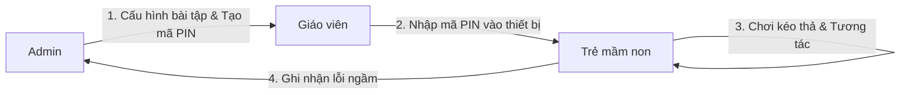

# Đặc tả Yêu cầu Sản phẩm (Product Requirements Document - PRD)

Tài liệu này xác định tầm nhìn sản phẩm, chân dung người dùng, các yêu cầu chức năng (FR) và phi chức năng (NFR) cho nền tảng web game giáo dục **Kid Game Edu** (phiên bản MVP và lộ trình mở rộng).

---

## 1. Tầm nhìn & Mục tiêu Sản phẩm

Xây dựng nền tảng trò chơi tương tác giáo dục hiện đại dành cho lứa tuổi mầm non (3–6 tuổi), ứng dụng phương pháp "học thông qua thực hành và vui chơi" (Play-based Learning).

- **Mục tiêu phiên bản MVP:** Cung cấp trải nghiệm trò chơi **"Kéo - Thả" (Drag & Drop)** mượt mà, trực quan, hỗ trợ mô hình lớp học mầm non thông qua cơ chế mã phòng (PIN) nhanh chóng, cho phép giáo viên dễ dàng khởi tạo phiên chơi và theo dõi kết quả của các nhóm học sinh.

---

## 2. Đối tượng Người dùng & Chân dung (User Personas)

| Vai trò | Chân dung & Đặc điểm | Nhu cầu chính & Trách nhiệm |
| :--- | :--- | :--- |
| **Trẻ mầm non (3–6 tuổi)** *(End-user)* | - Khả năng đọc chữ còn hạn chế. - Thao tác chạm/vuốt bằng ngón tay trên màn hình cảm ứng. - Dễ mất tập trung nếu ứng dụng bị trễ hoặc phức tạp. | - Tương tác trực tiếp bằng cách chạm, kéo thả đồ vật vào rổ. - Cần phản hồi thị giác và âm thanh ngay tức thì khi làm đúng hoặc sai. - Giao diện ngộ nghĩnh, màu sắc tươi sáng, biểu tượng to rõ. |
| **Giáo viên mầm non** *(Facilitator)* | - Cần điều phối lớp học đông trẻ (15–30 trẻ chia nhóm). - Thời gian chuẩn bị công nghệ trước giờ học rất ngắn. - Cần nắm bắt nhóm nào đang gặp khó khăn. | - Không phải đăng nhập tài khoản phức tạp trên từng máy tính bảng của trẻ. - Chỉ cần nhập mã PIN 6 số là mở ngay bài học cho trẻ. - Quan sát kết quả và số lỗi sai của nhóm sau giờ học. |
| **Quản trị viên (Admin)** *(Curator)* | - Chuyên viên nội dung hoặc giáo viên phụ trách học cụ. - Sử dụng máy tính bàn hoặc laptop. | - Tải lên hình ảnh giáo cụ mới (quả táo, quả cam, rổ màu,...). - Tạo kịch bản ghép đôi quả - rổ tương ứng. - Sinh mã PIN cho từng buổi học / nhóm học sinh. - Quản lý danh sách phòng chơi và theo dõi thống kê số lỗi. |

---

## 3. Phạm vi Sản phẩm (Scope Matrix)

### 3.1. Phân loại Tính năng theo MoSCoW

| Nhóm | Mã | Tính năng | Trạng thái hiện tại |
| :--- | :--- | :--- | :--- |
| **Must Have (Bắt buộc)** | `F-AUTH` | Đăng nhập tài khoản Quản trị viên bằng JWT. | Đã hoàn thành |
| | `F-GAME-CRUD` | Tạo, xem, cập nhật, xuất bản bài tập phân loại (Game). | Đã hoàn thành |
| | `F-SESSION` | Tạo phòng chơi cho nhóm học sinh, cấp mã PIN ngẫu nhiên 6 chữ số. | Đã hoàn thành |
| | `F-JOIN` | Nhập mã PIN để tham gia phòng chơi (không cần tài khoản trẻ em). | Đã hoàn thành |
| | `F-GAMEPLAY` | Kéo thả quả vào rổ với kiểm tra đúng/sai tức thời ở Client (Zero-latency). | Đã hoàn thành |
| | `F-FEEDBACK` | Hiệu ứng hình ảnh tức thì: Pháo hoa/sao chúc mừng khi xong, X đỏ khi sai. | Đã hoàn thành |
| | `F-MISTAKE` | Tự động ghi nhận số lượt kéo sai của từng mã PIN gửi ngầm về Backend. | Đã hoàn thành |
| **Should Have (Nên có)** | `F-UPLOAD` | Tải lên hình ảnh tài nguyên trực tiếp lên Cloudinary CDN. | Đã tích hợp qua FileStorageService |
| | `F-AUDIO` | Hiệu ứng âm thanh sinh động (tiếng vui nhộn khi đúng, tiếng nhắc nhở khi sai). | Dự kiến Phase 5 |
| | `F-DASHBOARD`| Xem bảng thống kê số lỗi sai theo từng nhóm học sinh trong ngày. | Đã hoàn thành trên UI Admin |
| **Won't Have (Ngoài phạm vi MVP)** | `F-REALTIME` | Đồng bộ hóa kéo thả thời gian thực đa thiết bị (WebSocket/WebRTC). | Để ngỏ cho các phiên bản sau |
| | `F-MULTI-ROLE`| Phân quyền đa tài khoản giáo viên với hồ sơ học sinh cá nhân. | Ngoài phạm vi MVP |
| | `F-LEADERBOARD`| Bảng xếp hạng cạnh tranh điểm số (không khuyến khích cạnh tranh ở lứa tuổi mầm non). | Ngoài phạm vi MVP |

---

## 4. Kịch bản Người dùng & Tiêu chí Nghiệm thu (User Stories & Acceptance Criteria)

### 4.1. `US-01`: Tham gia phòng chơi bằng mã PIN (`F-JOIN`)
- **User Story:** Là một Giáo viên, tôi muốn nhập mã PIN 6 số trên iPad để nhóm học sinh có thể bắt đầu bài học mà không cần đăng nhập tài khoản.
- **Tiêu chí nghiệm thu (Acceptance Criteria):**
  1. Giao diện hiển thị ô nhập mã PIN to, rõ ràng, hỗ trợ bàn phím số ảo (`inputmode="numeric"`).
  2. Khi nhập đủ 6 chữ số và nhấn "Let's go!" hoặc Enter:
     - Nếu mã PIN đúng và phòng đang mở (`isActive = true`), giao diện chuyển ngay sang màn hình Game trong thời gian < 1 giây.
     - Nếu mã PIN không tồn tại hoặc phòng đã đóng, hiển thị thông báo lỗi thân thiện: *"Mã phòng chưa đúng, thử lại nhé!"*.
  3. Cho phép truy cập đường dẫn đăng nhập dành riêng cho giáo viên quản lý ("Teacher login").

---

### 4.2. `US-02`: Trải nghiệm Gameplay Kéo - Thả (`F-GAMEPLAY`)
- **User Story:** Là một đứa trẻ mầm non, tôi muốn kéo các quả treo trên cây thả vào chiếc rổ có màu sắc tương ứng để hoàn thành bài tập phân loại trái cây.
- **Kịch bản 1: Kéo thả CHÍNH XÁC**
  - **Given:** Quả táo đỏ (`apple`) có đích đến là rổ màu đỏ (`basket-red`).
  - **When:** Trẻ chạm vào quả táo, kéo rê trên màn hình và thả vào vùng rổ đỏ.
  - **Then:**
    - Quả táo lập tức biến mất khỏi cây và được cố định vào rổ đỏ.
    - Rổ đỏ hiển thị biểu tượng tích xanh (`✓`).
    - Thanh tiến độ trên màn hình tăng lên (VD: "1 / 4 done").
- **Kịch bản 2: Kéo thả SAI VỊ TRÍ**
  - **Given:** Quả chanh vàng (`lemon`) có đích đến là rổ vàng (`basket-yellow`).
  - **When:** Trẻ kéo quả chanh và thả vào rổ đỏ (`basket-red`).
  - **Then:**
    - Rổ đỏ hiển thị biểu tượng dấu nhân đỏ (`×`) trong 650ms.
    - Quả chanh kích hoạt hoạt ảnh nảy ngược trở lại vị trí cũ trên cây (`.fruit-bounce-back`).
    - Client âm thầm gửi request POST `/api/gameplay/sessions/{pinCode}/mistakes` về Backend để tăng biến đếm lỗi của nhóm mà không gây đứng hình màn hình chơi.
- **Kịch bản 3: Thả ra NGOÀI VÙNG RỔ (Thả hụt)**
  - **When:** Trẻ kéo quả và thả ra ngoài khoảng không hoặc thả lại vào tán cây.
  - **Then:** Quả tự động quay trở về vị trí cũ trên cây, không tính là một lỗi sai.
- **Kịch bản 4: HOÀN THÀNH MÀN CHƠI**
  - **When:** Quả cuối cùng trong danh sách được xếp đúng vào rổ.
  - **Then:** Hiển thị màn hình chúc mừng lớn với biểu tượng ngôi sao: *"⭐ You did it! ⭐"*.

---

### 4.3. `US-03`: Quản trị viên Cấu hình Bài tập & Tạo Phòng (`F-ADMIN-CONFIG`)
- **User Story:** Là Quản trị viên, tôi muốn tạo một bài học mới và cấp mã PIN cho lớp học.
- **Tiêu chí nghiệm thu (Acceptance Criteria):**
  1. Admin đăng nhập bằng tài khoản quản trị để nhận JWT Token.
  2. Admin có thể nhập tiêu đề game, thiết lập liên kết giữa các quả và các rổ tương ứng.
  3. Có thể tải ảnh tùy chỉnh từ máy tính lên Cloudinary cho từng quả.
  4. Sau khi lưu, bài học xuất hiện trong danh sách lựa chọn để tạo phòng.
  5. Khi chọn bài học và nhập tên nhóm (VD: "Sunflowers"), hệ thống sinh ra mã PIN 6 số duy nhất và hiển thị nổi bật trên màn hình.
  6. Admin có thể xem danh sách các phòng đang chạy cùng số lỗi sai phát sinh trong thời gian thực khi bấm nút "Refresh".

---

## 5. Yêu cầu Phi chức năng (Non-Functional Requirements - NFR)

### 5.1. Hiệu năng & Tốc độ Phản hồi (Performance & Latency)
- **Zero-Latency UI:** Phản hồi kéo thả và kiểm tra đúng/sai phải hoàn thành trong vòng **< 50ms** (ngay lập tức trong khung hình tiếp theo).
- **Tải ban đầu (Initial Load):** Kích thước bundle ứng dụng gọn nhẹ, thời gian tải trang ban đầu < 2.5s trên mạng 4G/Wifi trường học.
- **Tải đồng thời:** Hệ thống Backend và Database MongoDB đáp ứng mượt mà tối thiểu **15–30 nhóm chơi đồng thời** trong cùng một tiết học mà không bị nghẽn mạng.

### 5.2. Khả năng Tương thích & Thiết kế Đáp ứng (Responsiveness & Compatibility)
- **Thiết bị mục tiêu:**
  - Máy tính bảng (iPad 9.7", 10.2", iPad Air, iPad Pro, Android Tablet 10"): Tỉ lệ màn hình 4:3 và 16:10.
  - Máy tính xách tay & màn hình tương tác thông minh (Laptop, Smart Board): Tỉ lệ 16:9.
- **Chuẩn kích thước vùng chạm (Touch Target Guidelines):**
  - Đối tượng quả: Tối thiểu $64 \times 64\text{ px}$ (chuẩn tối ưu cho ngón tay trẻ nhỏ là $80 \times 80\text{ px}$).
  - Vùng thả rổ: Tối thiểu $180 \times 120\text{ px}$.
  - Khoảng cách giữa các vật thể tối thiểu 16px để tránh việc trẻ chạm nhầm nhiều quả cùng lúc.

### 5.3. Độ tin cậy & Xử lý Ngoại lệ (Reliability & Fault Tolerance)
- Nếu kết nối mạng Backend tạm thời bị gián đoạn trong khi đang chơi: Trẻ em vẫn tiếp tục chơi được bình thường vì toàn bộ logic game chạy ở Client. Request gửi lỗi sai sẽ tự động bỏ qua lỗi âm thầm (`error: () => undefined`) mà không làm văng ứng dụng hoặc hiện popup làm trẻ hoang mang.

### 5.4. Bảo mật & An toàn (Security)
- Thông tin quản trị được bảo vệ bằng JWT và BCrypt hash.
- Không thu thập bất kỳ dữ liệu định danh cá nhân nhạy cảm nào của trẻ mầm non (PII - Personally Identifiable Information). Mã phòng chỉ gắn với tên nhóm lớp chung (VD: "Lớp Chồi 1", "Nhóm Hướng Dương").
