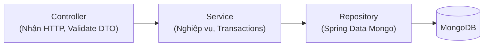

# Hướng dẫn dành cho GitHub Copilot & AI Assistants

Tài liệu này cung cấp các nguyên tắc kiến trúc, quy chuẩn mã nguồn và mẫu lập trình bắt buộc nhằm hỗ trợ GitHub Copilot (và các công cụ AI hỗ trợ lập trình) sinh mã chính xác, tối ưu, bảo mật và nhất quán với dự án **Kid Game Edu**.

---

## 1. Bối cảnh Dự án & Tech Stack

Kid Game Edu là hệ thống web game giáo dục tương tác dành cho trẻ mầm non (3–6 tuổi), ưu tiên tối đa tính mượt mà, phản hồi lập tức và tính ổn định trong môi trường lớp học.

| Thành phần | Công nghệ / Thư viện | Quy chuẩn & Đặc thù |
| :--- | :--- | :--- |
| **Backend** | Java 17, Spring Boot 3.4.4 | RESTful API, Lombok, Spring Security, Validation |
| **Frontend** | Angular 18.2, Tailwind CSS 3.4 | Standalone Components, Angular Signals, Angular CDK |
| **Database** | MongoDB | Document Database, BSON ObjectIds, Custom Indexes |
| **Lưu trữ** | Cloudinary | Tích hợp qua Interface abstraction `FileStorageService` |
| **Cấu trúc repo** | Monorepo (`backend/` & `frontend/`) | Độc lập về cấu hình build và môi trường chạy |

---

## 2. Nguyên tắc Bất biến (Core Invariants)

1. **Gameplay Logic Nằm Trọn ở Frontend (Zero-Latency Rule):**
   - **BẮT BUỘC:** Toàn bộ logic kiểm tra đúng hay sai khi trẻ kéo thả đối tượng vào rổ phải được xử lý ngay tại trình duyệt (Angular CDK Drag & Drop).
   - **TUYỆT ĐỐI KHÔNG:** Viết API kiểm tra đáp án kéo thả ở Backend. Backend chỉ nhận API gửi ngầm (`POST /api/gameplay/sessions/{pinCode}/mistakes`) để lưu vết số lần thao tác sai phục vụ thống kê.
2. **Quy tắc Trừu tượng hóa Dịch vụ Ngoài (Dependency Inversion):**
   - Không được phép inject trực tiếp SDK của Cloudinary vào các Business Service hoặc Controller.
   - Mọi thao tác lưu trữ file bắt buộc phải gọi thông qua interface `FileStorageService`.
3. **Phân quyền & Định danh Người dùng:**
   - Các API quản trị (`/api/admin/**`): Yêu cầu xác thực JWT qua header `Authorization: Bearer <TOKEN>`.
   - Các API học sinh / lớp học (`/api/gameplay/**`): Định danh qua `pinCode` 6 số hợp lệ, không dùng tài khoản hay cookie session.
4. **Không Hardcode Thông tin Nhạy cảm:**
   - Tuyệt đối không hardcode database credentials, Cloudinary API Key, hoặc JWT Secret trong code. Luôn đọc từ biến môi trường qua `application.yml` (`${VAR_NAME:default_value}`).

---

## 3. Quy chuẩn Viết Code Backend (Java / Spring Boot)

### 3.1. Phân tầng Kiến trúc (Layered Architecture)
Tuân thủ nghiêm ngặt luồng: `Controller` $\rightarrow$ `Service` $\rightarrow$ `Repository` $\rightarrow$ `Model`.



### 3.2. Sử dụng Lombok & DTO Validation
- Sử dụng Lombok (@Data, @Builder, @NoArgsConstructor, @AllArgsConstructor) để giữ code ngắn gọn.
- Mọi request payload vào Controller phải có `@Valid` và các annotation kiểm tra dữ liệu như `@NotBlank`, `@NotNull`:
  ```java
  @PostMapping
  public ResponseEntity<Session> create(@Valid @RequestBody CreateSessionRequest request) {
      return ResponseEntity.status(HttpStatus.CREATED)
              .body(sessionService.create(request.getGameId(), request.getGroupName()));
  }

  public static class CreateSessionRequest {
      @NotBlank(message = "gameId must not be blank")
      private String gameId;

      @NotBlank(message = "groupName must not be blank")
      private String groupName;
      // Getters & Setters
  }
  ```

### 3.3. Xử lý Ngoại lệ Tập trung (Global Exception Handling)
- Sử dụng `@RestControllerAdvice` (`GlobalExceptionHandler`) để bắt lỗi và trả về JSON chuẩn, không để lộ stack trace cho client:
  ```java
  @ExceptionHandler(ResourceNotFoundException.class)
  public ResponseEntity<Map<String, String>> handleNotFound(ResourceNotFoundException ex) {
      return ResponseEntity.status(HttpStatus.NOT-FOUND)
              .body(Map.of("error", ex.getMessage()));
  }
  ```

---

## 4. Quy chuẩn Viết Code Frontend (TypeScript / Angular)

### 4.1. Standalone Components & Signals
- Không sử dụng NgModule. Khai báo component độc lập với `standalone: true`.
- Quản lý trạng thái UI bằng Angular Signals (`signal<T>()`, `computed()`):
  ```typescript
  export class AppComponent {
    readonly pin = signal('');
    readonly joined = signal(false);
    readonly placed = signal<string[]>([]);
    readonly completed = signal(false);

    markCorrect(id: string): void {
      if (!this.placed().includes(id)) {
        this.placed.update(items => [...items, id]);
      }
    }
  }
  ```

### 4.2. Angular CDK Drag & Drop
- Xử lý kéo thả bằng directive `cdkDropList` và `cdkDrag`.
- Thiết lập liên kết các drop zones thông qua `cdkDropListConnectedTo`:
  ```html
  <div class="tree-area" cdkDropList [id]="treeDropListId" [cdkDropListConnectedTo]="dropListIds">
    <div *ngFor="let fruit of items" cdkDrag [cdkDragData]="fruit">
      
    </div>
  </div>
  ```

### 4.3. Styling & Thiết kế Touch-Friendly (Tailwind CSS)
- Kích thước các nút bấm và phần tử chạm cho trẻ phải đạt tối thiểu $64\text{px}$ để ngón tay dễ tương tác:
  ```html
  <button type="button" class="min-w-[64px] min-h-[64px] rounded-2xl ...">
  ```
- Luôn kiểm tra giao diện trên màn hình Tablet/iPad bằng cách sử dụng các tiền tố responsive của Tailwind (`md:`, `lg:`).

---

## 5. Tài liệu Tham chiếu Thiết kế

Khi cần tìm hiểu chi tiết về cấu trúc hệ thống, Copilot cần phân tích các tài liệu sau trước khi sinh mã:

- [PRODUCT_REQUIREMENTS.md](./PRODUCT_REQUIREMENTS.md): Đặc tả yêu cầu sản phẩm, tiêu chí nghiệm thu và tiêu chuẩn UI trẻ em.
- [ARCHITECTURE.md](./ARCHITECTURE.md): Kiến trúc phân tầng, danh sách REST API và quyết định thiết kế.
- [DATABASE.md](./DATABASE.md): Thiết kế Schema MongoDB, chỉ mục (Indexes) và JSON mẫu.
- [IMPLEMENTATION_PLAN.md](./IMPLEMENTATION_PLAN.md): Lộ trình triển khai và trạng thái từng task.
- [README.md](./README.md): Hướng dẫn cài đặt, khởi chạy cục bộ và cấu hình biến môi trường.

---

## 6. Danh mục Hành vi Cấm (Restrictions & Don'ts)

| Hành vi bị cấm | Lý do |
| :--- | :--- |
| **CẤM** đưa logic kiểm tra kết quả kéo thả về Backend | Làm chậm phản hồi cho trẻ mầm non, phá vỡ nguyên tắc Zero-Latency. |
| **CẤM** tự ý thay đổi cấu trúc Schema MongoDB nếu chưa được phê duyệt | Gây vỡ tương thích dữ liệu giữa Backend và Frontend DTOs. |
| **CẤM** commit thông tin nhạy cảm (passwords, tokens, keys) lên git | Vi phạm bảo mật. Các file như `.env`, `atlas-credentials.env` phải được bảo vệ. |
| **CẤM** sử dụng các thư viện realtime nặng (như WebSocket full-duplex) cho luồng kéo thả cơ bản | Phiên bản MVP không yêu cầu đồng bộ thời gian thực đa thiết bị, tránh phát sinh chi phí hạ tầng. |
